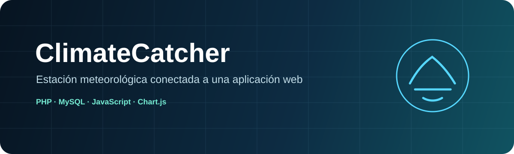
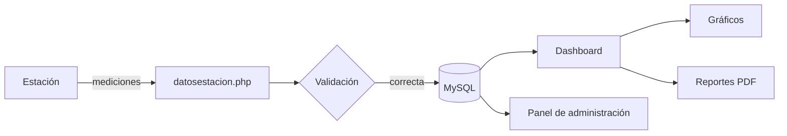

<p align="center">
  
</p>

<p align="center">
  
  
  
  
</p>

<p align="center">
  <a href="#climatecatcher">Resumen</a> ·
  <a href="#funcionamiento">Funcionamiento</a> ·
  <a href="#tecnologías">Tecnologías</a> ·
  <a href="#ejecución-local">Ejecución local</a> ·
  <a href="docs/ARCHITECTURE.md">Arquitectura</a> ·
  <a href="SECURITY.md">Seguridad</a>
</p>

## ClimateCatcher

ClimateCatcher conecta una **estación meteorológica** con una aplicación web. La estación envía mediciones al servidor, PHP las procesa, MySQL las guarda y el dashboard permite consultar los datos de forma visual.

El proyecto trabaja con **temperatura, humedad, luminosidad y presión atmosférica**. Además del valor actual, la web permite revisar historial, mínimos, máximos, promedios, gráficos y reportes.

### Funciones principales

- recepción de mediciones enviadas por la estación;
- validación del código de estación;
- almacenamiento de datos en MySQL;
- registro e inicio de sesión de usuarios;
- asociación entre usuarios y estaciones;
- estadísticas e historial por fecha;
- gráficos con Chart.js;
- generación de reportes PDF;
- panel separado para administración de usuarios y estaciones.

## Funcionamiento



El recorrido de una medición es simple: la estación manda los valores, `datosestacion.php` recibe y valida la solicitud, `insertardatos.php` guarda la medición y el dashboard consulta esos registros para mostrarlos al usuario.

## Tecnologías

| Parte | Herramientas |
| --- | --- |
| Backend | PHP, PDO |
| Base de datos | MySQL |
| Frontend | HTML, CSS, JavaScript |
| Gráficos | Chart.js |
| Reportes | FPDF |

<details>
<summary><strong>Ver estructura del proyecto</strong></summary>

```text
ClimateCatcher/
├── assets/
├── css/
├── imagen/
├── conexion.php
├── datosestacion.php
├── insertardatos.php
├── dashboard.php
├── dashboard_admin.php
├── generar_reporte.php
├── login.php
├── login_admin.php
├── registro.php
├── logout.php
├── producto.php
├── index.html
├── scripts.js
├── styles.css
├── .env.example
├── SECURITY.md
└── docs/
    └── ARCHITECTURE.md
```

</details>

## Ejecución local

Para levantarlo localmente hace falta un entorno con PHP, MySQL o MariaDB y un servidor como Apache/XAMPP.

La conexión a la base de datos se configura mediante variables de entorno:

```bash
DB_HOST=localhost
DB_NAME=climatecatcher
DB_USER=usuario
DB_PASSWORD=contraseña
```

`.env.example` deja indicadas las variables necesarias sin guardar credenciales reales dentro del repositorio.

<details>
<summary><strong>Ver formato de recepción de datos</strong></summary>

La estación envía las mediciones al endpoint:

```text
datosestacion.php?api_key=ESTACION&humidity=...&temperature=...&luminosity=...&pressure=...
```

El servidor valida la estación antes de procesar la medición y responde en JSON.

</details>

## Seguridad

Las credenciales de la base de datos no están escritas dentro del código. El archivo [SECURITY.md](SECURITY.md) reúne los puntos que conviene revisar si en algún momento se retoma la implementación, especialmente autenticación de estaciones y manejo de contraseñas.

## Documentación

En [docs/ARCHITECTURE.md](docs/ARCHITECTURE.md) está explicado con más detalle cómo se reparten las responsabilidades entre los archivos y cómo circulan los datos.
